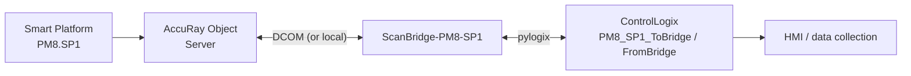

# ScanBridge 1.1

**ABB AccuRay Smart Platform frame → ControlLogix data transport.** One instance per frame (`PM8.SP1`, `PM8.SP2`, …).

ScanBridge connects to the AccuRay Object Server (OPC DA over DCOM, remote or local), keeps a live model of one frame, and builds the cross-direction profiles. It writes everything to a ControlLogix PLC with pylogix. The PLC commands the scanner back through the same path. HMIs and data-collection software only talk to the PLC.



## What the PLC gets (per measurement channel, e.g. WT1, MO1, CA1, AC1)

| Member | Updates | Purpose |
|---|---|---|
| `PV`, `PVSeq`, `Quality` bit 0 | **every 5 s** (TBM5S) | PID process variable (full-width rolling average) + valid flag |
| `LiveProfile[600]`, `RollAvg`, `Roll2Sigma` | every 5 s | rolling CD profile for data collection |
| `Profile[600]`, `ScanAvg`, `Scan2Sigma`, `ScanSeq` | each completed scan | edge-to-edge scan profile |

It also gets frame state, sensor status/shutter/slope/offset, a ReqID command handshake (scan, standardize, online/offline, slope/offset, any writable device tag, grade setup table), and health counters.

## How it stays up

| Failure | Recovery |
|---|---|
| OPC/DCOM error | worker reconnects itself (2 → 60 s) |
| Hung DCOM call | worker process killed and respawned |
| TBM data stalls | reconnect, then respawn |
| PLC link down | reconnect; requests made meanwhile expire (−9) |
| Internal fault | exit, and the service manager restarts it |

## Quick start

```bat
py -3.14-32 -m pip install -r requirements.txt
py -3.14-32 -m scanbridge simulate -c config\simulate.toml --fake-plc          & rem bench, no hardware
copy config\scanbridge.example.toml sites\PM8-SP1\scanbridge.toml              & rem set node, item_prefix, PLC
py -3.14-32 -m scanbridge discover -c sites\PM8-SP1\scanbridge.toml            & rem as .\win_dcom_user
py -3.14-32 -m scanbridge gen-l5x  -c sites\PM8-SP1\scanbridge.toml -o sites\PM8-SP1\plc
py -3.14-32 -m scanbridge test-plc -c sites\PM8-SP1\scanbridge.toml
tools\install_service.cmd PM8-SP1 C:\ScanBridge\sites\PM8-SP1\scanbridge.toml <password>
```

## Documentation

| Document | For |
|---|---|
| [01 Architecture](docs/01_Architecture.md) | ABB terms, process layout, data flow, state machines (Mermaid) |
| [02 PLC Interface](docs/02_PLC_Interface.md) | UDTs, handshake, codes, quality bits, ST examples, PID notes |
| [03 Installation](docs/03_Installation.md) | step-by-step with checks |
| [04 Operation](docs/04_Operation.md) | normal indications, operating, failures, maintenance |
| [05 Troubleshooting](docs/05_Troubleshooting.md) | decision tree, DCOM/PLC fixes, every SB-xxx ID |

## Tests

```bat
py -3.14-32 -m pytest tests\test_units.py -q
py -3.14-32 tests\test_e2e_sim.py config\simulate.toml
py -3.14-32 tests\test_recovery.py config\simulate.toml
```

The simulator uses your item-ID scheme (`SIM.SP1.WT1.MEAS.TBM5S`), so discovery, model, PLC writes, commands and recovery are all exercised without hardware. Only the DCOM layer (`opc_worker.py`) needs a real AOS.

## Changes in 1.1

* Item IDs `MACHINE.FRAME[.SENSOR.SECTION].Tag` are parsed directly. `opc.item_prefix` scopes one instance to one frame. `discover` lists the frames.
* TBM5S is the default. The rolling profile and average are updated every refresh, and `PV` is selectable (`rolling` / `scan`).
* `LiveProfile` is always in the UDT and written every refresh, for data collection.
* Local AOS supported (`node = ""`).
* Setup on connect is now off by default. Writing a slope of 0 is refused.
* Tag names default to `PM8_SP1_*`.
