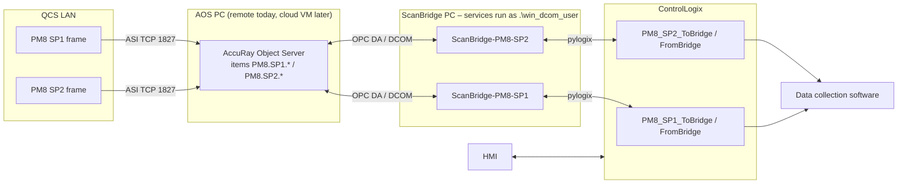
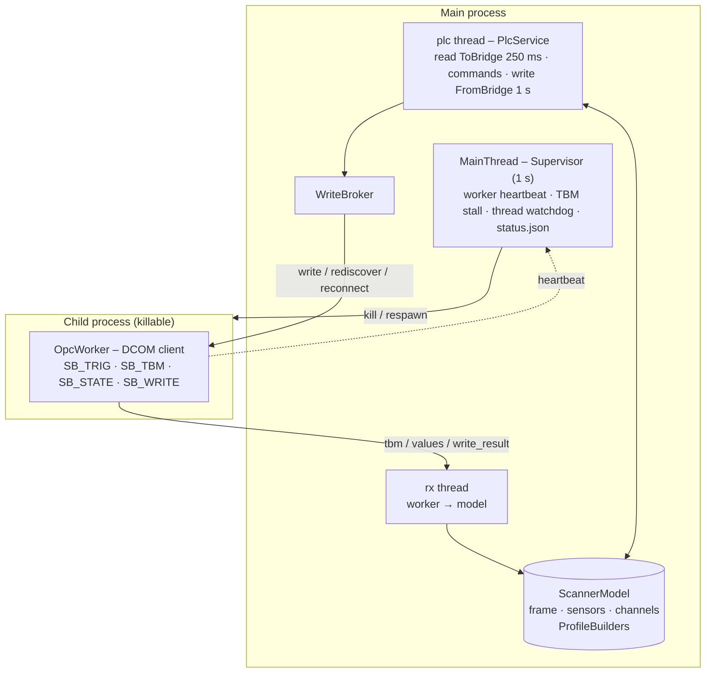
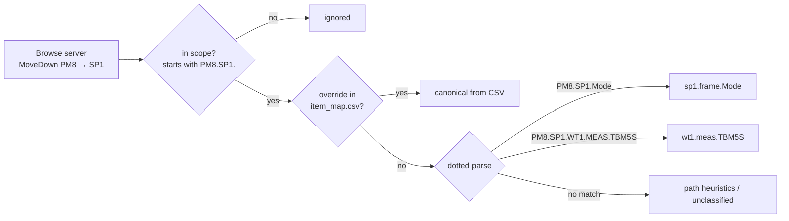
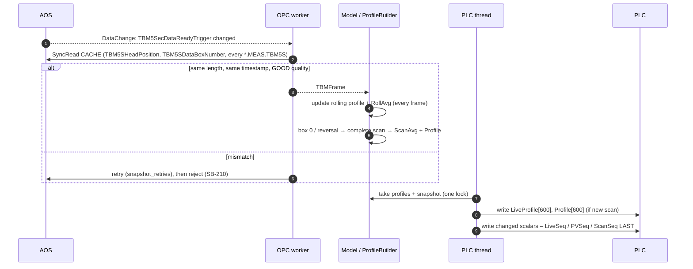
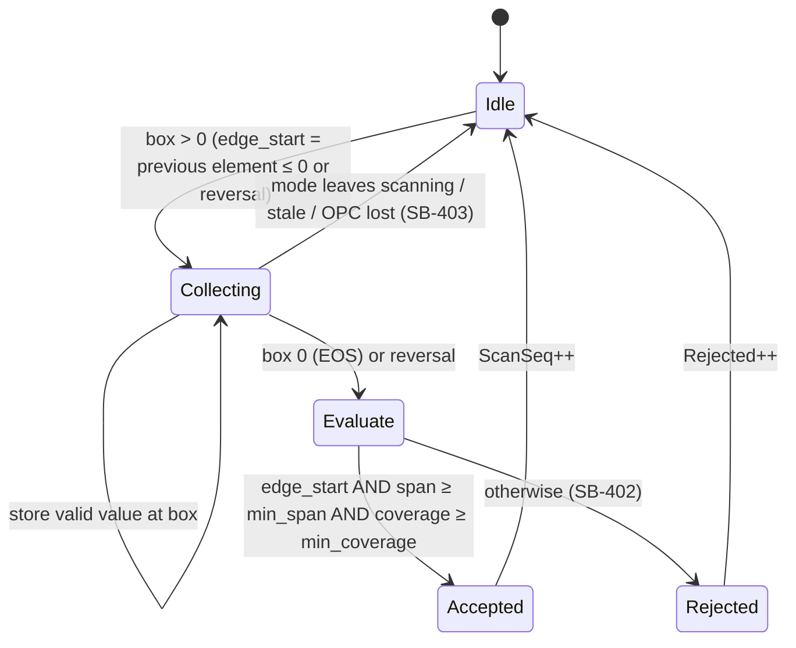
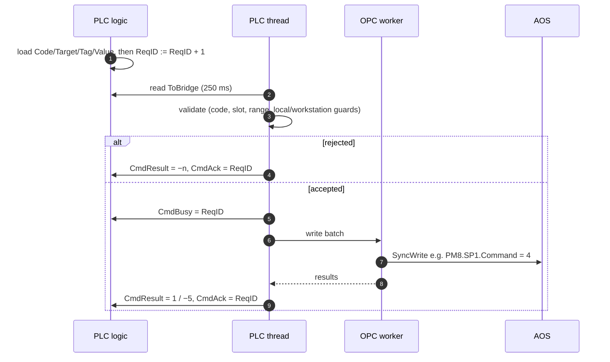
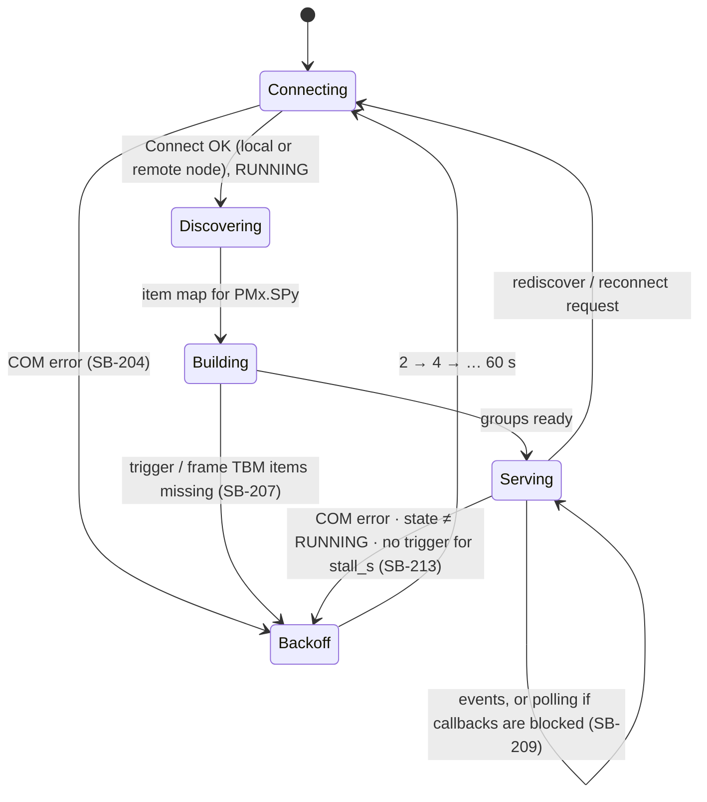
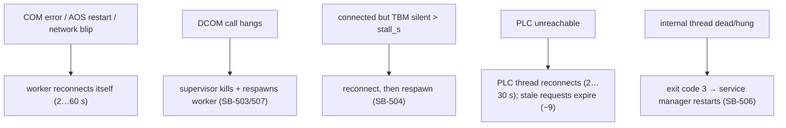

# ScanBridge – Architecture and Program Flow

ScanBridge moves data between **one ABB AccuRay Smart Platform frame** (through the AccuRay Object Server, OPC DA over DCOM) and a **ControlLogix PLC** (EtherNet/IP through pylogix). The scanner model lives inside ScanBridge, and the PLC is the only way in. HMIs and data-collection software talk to the PLC, never to ScanBridge.

## 0. Terms used by ABB, and what they mean here

| ABB term | What it is | In this system |
|---|---|---|
| **Smart Platform** (Scanning Platform) | The scanner frame itself: the O-frame, the measuring head and its sensors, and the frame's own controller (ASPC). It talks to the AOS over ASI, TCP 1827. | Each `PMx.SPy` branch in the OPC server is one Smart Platform |
| **AccuRay Object Server (AOS)** | Windows OPC DA server. It translates OPC items into ASI messages for one or more frames. It's a gateway, not a controller. | `AccuRay.Object.Server.1`, today remote, later on your cloud VM |
| **Host / controlling host** | The supervisory system that commands the frame through the AOS (scan, standardize, grade data). ABB's own QCS workstation fills this role in a full ABB system. | **ScanBridge, on behalf of the PLC.** The PLC decides, ScanBridge executes |
| **Workstation in control** (`WorkStnControlCode = 1`) | An ABB operator workstation has taken control of the frame | ScanBridge refuses host commands (result −8) |
| **(M\*) items** | Values the host should supply on connection and on grade change (scan time, box count, slopes/offsets…) | `ToBridge.Setup[]` table, written only when you ask (§ PLC Interface 7) |
| **TBM** (time-based measurement) | Array snapshots published every 1 s (TBM1S) or 5 s (TBM5S) | **TBM5S** by default |

## 1. System context

**One ScanBridge instance per frame.** Each instance has its own config (`opc.item_prefix = "PM8.SP1"`), its own Windows service, its own PLC tag pair, and its own logs. A fault on one frame never affects another.

## 2. Processes and threads (one instance)

A DCOM call to an unreachable node can block for minutes, and you can't interrupt it from Python. So DCOM lives in a child process that the supervisor can kill. MQTT is gone: the in-memory model is the buffer, and `status.json` plus the PLC `Sts` counters show that data is moving.

## 3. Discovery (item IDs → canonical keys)

The frame is always `sp1` internally, because ABB's device tag for every frame is `sp1yyy`: `PM10.SP2.TBM1SDataBoxNumber` is device tag `sp1006`. The item-ID prefix is what keeps frames apart.

## 4. TBM data path (every 5 s)

## 5. Two averages, two profiles

| PLC member | Updated | Built from | Use |
|---|---|---|---|
| `LiveProfile[600]`, `RollAvg`, `Roll2Sigma` | every TBM refresh (5 s) | the latest value of every box, dropping boxes older than `live_max_age_scans` × scan time (2 × by default) | **PID PV** (default `pv_source = "rolling"`), trending, data collection |
| `Profile[600]`, `ScanAvg`, `Scan2Sigma` | once per completed scan | one edge-to-edge pass | Reports, CD analysis, `pv_source = "scan"` |
| `Live` | every refresh | only the boxes crossed in the last 5 s | Diagnostics. Not representative of the full width |

`PV` equals whichever average `pv_source` selects, and `PVSeq` counts its updates.

## 6. Profile builder

The rolling profile is updated from **every** valid positive box, whatever this state machine is doing. Invalid elements (−1000000) never enter either profile.

## 7. Request handshake

## 8. OPC worker connection states

## 9. Recovery layers

While any of these is recovering, `Chan[n].Quality` bit 0 drops within `stale_s` (13.5 s at TBM5S), so PLC loops hold.

## 10. Source map

| Module | Responsibility |
|---|---|
| `catalog.py` | Device tags, status bits, enumerations from the ABB manuals |
| `discovery.py` | Item IDs → canonical keys, frame scoping, CSV overrides |
| `opc_worker.py` | DCOM client: local/remote connect, scoped browse, groups, snapshots, writes |
| `sim_worker.py` | Simulator using your item-ID scheme (bench testing) |
| `tbm.py` / `profile.py` | TBM frame validation; rolling and completed-scan profiles |
| `model.py` | Scanner model, PV selection, quality bits, PLC snapshot |
| `plc_types.py` | **Single source of truth** for UDTs and codes |
| `l5x.py` | L5X generator (v20) |
| `plc_link.py` / `plc_service.py` | pylogix wrapper (ENBT/EN2T chunking) and the PLC thread |
| `commands.py` | Request validation, guards, setup table |
| `supervisor.py` | Process/thread supervision, status |
| `store.py` | SQLite history and audit |
