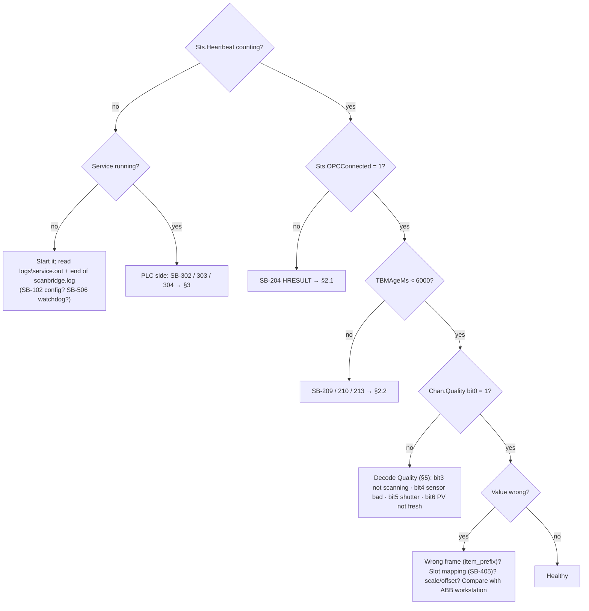

# ScanBridge – Troubleshooting Guide

**Start here.** Three places tell you what's wrong, in this order:

1. **PLC** `<frame>_FromBridge.Sts`: Heartbeat, State, OPCConnected, PLCHbOK, TBMAgeMs, LastError (the number of the last SB-xxx problem).
2. **PC** `py -3.14-32 -m scanbridge status -c <config>`: model state, decoded sensor status, and per-channel quality.
3. **Log** `logs\scanbridge.log`: every important line has an ID like `[SB-204]`; look it up in §4. WARNING and above also go to the Windows Application log under *ScanBridge-<site>*.

## 1. Decision tree

## 2. Scanner / DCOM

### 2.1 Connection errors (SB-204 / 203 / 205)

| HRESULT in log | Meaning | Fix |
|---|---|---|
| `E_ACCESSDENIED 0x80070005` | DCOM refused the identity | `win_dcom_user` must exist on **both** PCs with the same password; check AOS Access/Launch rights; **reboot** after changes; confirm the service runs as `.\win_dcom_user` |
| `RPC_S_SERVER_UNAVAILABLE 0x800706BA` | AOS PC unreachable | ping **both ways**; firewall TCP 135 + dynamic RPC; AOS service started; `opc.node` |
| `RPC_S_CALL_FAILED` / `RPC_E_DISCONNECTED` | link or server dropped mid-call | recovers on its own; if it repeats, check NIC/switch errors and the AOS Event Viewer |
| `CO_E_SERVER_EXEC_FAILURE 0x80080005` | AOS couldn't start | AOS PC Event Viewer → Application: licence, Identity tab |
| `REGDB_E_CLASSNOTREG 0x80040154` | OPC Automation wrapper missing (32-bit) | install x86 OPC Core Components; run **32-bit** Python |
| SB-205 state ≠ RUNNING | AOS not serving | Data Dictionary not configured (ABB guide) |
| SB-203 connect took 45–60 s | multi-homed PC binds RPC to the wrong NIC | put the AOS-facing NIC first in metric/binding order |

These remote-DCOM issues go away once the AOS runs on the same VM (`node = ""`).

### 2.2 Connected, but no data

| Log | Meaning | Fix |
|---|---|---|
| **SB-209** callbacks not arriving | AOS can't call back into this PC | `dcomcnfg` → COM Security → Access Permissions → Edit Limits: allow the AOS's account Remote Access; reboot. Polling keeps data flowing meanwhile |
| SB-209 makepy unavailable | early-bound wrapper missing | run makepy (Installation §3) as admin |
| **SB-213** no trigger change | AOS gets no frame data | AOS event log: "Waiting 10 seconds for tag reassignment"; check the QCS LAN / frame power (ASI TCP 1827) |
| **SB-207** required item missing | `PMx.SPy.TBM5SecDataReadyTrigger`, `TBM5SHeadPosition` or `TBM5SDataBoxNumber` not found | check `item_prefix` spelling; check `item_map.discovered.csv`; does the Data Dictionary contain 5S tags? (otherwise `tbm_rate = "1S"`) |
| **SB-210** snapshot rejected | TBM items not updated together | occasional: fine. Constant: raise `timestamp_tolerance_ms` (500 → 1000) |
| **SB-211** length mismatch | an array length differs | a 1S/5S mix in overrides |
| **SB-212** gaps | refreshes missed | CPU, network, antivirus on the logs folder |

### 2.3 Discovery (SB-206 / 208 / 405)

* **Wrong frame's data:** `item_prefix` must be exactly `MACHINE.FRAME` (e.g. `PM8.SP1`). Run `discover` with an empty prefix to list them.
* **Sensor missing:** item IDs must look like `PM8.SP1.WT1.MEAS.TBM5S`. Section tokens other than `MEAS` (`STDZ`, `SMPLCHK`, `CALSMPL`) are best guesses; see `how = unclassified` rows in `item_map.discovered.csv` and add overrides.
* **SB-405 auto-assigned slot:** pin it in the config so weight can never move to another slot.
* **"OPC items changed since last discovery":** the Data Dictionary was edited; verify slots.

## 3. PLC

| Log | Meaning | Fix |
|---|---|---|
| **SB-302** connect failed / lost | no EtherNet/IP session | ping; `plc.ip` / `slot`; ENBT → `connection_size = 508`; module connection count |
| **SB-303** layout mismatch | tags missing or sized differently | import the UDTs generated from **this** config; create both tags; External Access Read/Write |
| **SB-304** `Path segment error` | missing member (old UDT) | regenerate + re-import |
| **SB-304** privilege / external access | tag is Read Only externally | External Access = Read/Write |
| **SB-305** PLC heartbeat stale | logic not incrementing `ToBridge.Heartbeat` | PLC in Program mode or routine not scheduled |
| **SB-310** request discarded (−9) | ReqID changed while the link was down | re-issue |
| **SB-309** rejected | see `CmdResult` | −7 WriteEnable · −8 LOCAL/workstation · −6 range or slope 0 |
| **SB-215** OPC write failed | server refused | HRESULT in log: BADRIGHTS / BADTYPE / RANGE |

## 4. Log ID reference

| ID | Level | Meaning | Action |
|---|---|---|---|
| SB-101 | INFO | Start / stop | – |
| SB-102 | ERROR | Config invalid (exits) | `scanbridge check` |
| SB-103 | WARN | Event log source not registered | start once as administrator |
| SB-200 | INFO | OPC worker exiting | – |
| SB-201 | INFO | Connecting | – |
| SB-202 | INFO | Connected / groups ready / online | – |
| SB-203 | WARN | Slow DCOM connect | §2.1 |
| SB-204 | ERROR | OPC connect failed / lost (HRESULT) | §2.1 |
| SB-205 | ERROR | Server not RUNNING | §2.1 |
| SB-206 | INFO/WARN | Discovery result / items changed | §2.3 |
| SB-207 | ERROR | Required item missing / cannot add | §2.2 |
| SB-208 | INFO/WARN | Unclassified or duplicate items | §2.3 |
| SB-209 | WARN | Events unavailable → polling | §2.2 |
| SB-210 | WARN | TBM snapshot rejected | §2.2 |
| SB-211 | WARN | TBM length mismatch | §2.2 |
| SB-212 | WARN | TBM refreshes missed | §2.2 |
| SB-213 | ERROR | TBM trigger stalled | §2.2 |
| SB-214 | INFO | OPC write OK | – |
| SB-215 | ERROR | OPC write failed | §3 |
| SB-216 | INFO/WARN | CoInitializeSecurity | if SB-209 follows, §2.2 |
| SB-217 | INFO | Decoded sensor configuration array | – |
| SB-218 | INFO/WARN | Sensor status / stdz / maintenance alarms | decode bits; ABB maintenance |
| SB-219 | WARN | Bad trigger quality | §2.2 |
| SB-299 | ERROR | Exception in DataChange | send log |
| SB-300 | INFO | PLC service start/stop | – |
| SB-301 | INFO | PLC connected | – |
| SB-302 | WARN | PLC connect failed / lost | §3 |
| SB-303 | ERROR | PLC layout mismatch | §3 |
| SB-304 | WARN | PLC writes failed | §3 |
| SB-305 | WARN | PLC heartbeat stale | §3 |
| SB-306 | INFO | PLC heartbeat OK | – |
| SB-307 | INFO | Request received | – |
| SB-308 | INFO | Request finished | – |
| SB-309 | WARN/ERROR | Request rejected / timeout | §3 |
| SB-310 | WARN | Stale request discarded | §3 |
| SB-311 | INFO/ERROR | Automatic setup | Operation §4 |
| SB-399 | ERROR | Unexpected PLC-cycle error | send log |
| SB-401 | DEBUG | Scan accepted | – |
| SB-402 | INFO | Scan rejected (partial/span/coverage) | §5 |
| SB-403 | INFO | Scan aborted (mode change) | normal |
| SB-404 | ERROR | NumberOfDataBoxes > profile_len | raise profile_len, regenerate UDTs |
| SB-405 | INFO/WARN | Slot assignment / configured item absent | §2.3 |
| SB-406 | INFO | Mode / control / stdz complete | – |
| SB-407 | WARN/INFO | Alarm / DI change, AEOS error | check frame |
| SB-408 | INFO | Shutter open/closed | – |
| SB-450 | WARN | SQLite write failed | disk / permissions |
| SB-501 | INFO | Worker started | – |
| SB-502 | ERROR | Worker exited | repeated → support |
| SB-503 | WARN | Worker stopped (hung / shutdown) | repeated → §2 |
| SB-504 | WARN | TBM stalled → reconnect | §2.2 |
| SB-505 | CRITICAL | Internal thread died/hung | send log |
| SB-506 | CRITICAL | Exit for service restart | automatic |
| SB-507 | ERROR | Worker restart scheduled | – |
| SB-508 | WARN | status.json not writable | permissions |
| SB-599 | ERROR | Error handling worker message | send log |

## 5. Quality bits

| Bit | Meaning when SET |
|---|---|
| 0 | PV valid (bits 1-6 all set) |
| 1 | OPC connected |
| 2 | TBM data fresh |
| 3 | Frame scanning |
| 4 | Sensor status OK |
| 5 | Shutter open / not applicable |
| 6 | PV fresh (rolling: enough fresh boxes; scan: last scan < 3 scan times old) |
| 7 | Sensor standardizing |
| 8 | Sensor sample checking |
| 9 | Last scan rejected |
| 10 | Frame in single point |
| 11 | Rolling profile coverage OK |

* **Bit 6 clear while scanning (rolling PV):** the rolling profile doesn't cover enough of the sheet yet. After start-up or a mode change this takes up to one full scan. Before the first complete scan, 80 % of NumberOfDataBoxes must be fresh.
* **Bit 4 clear:** run `scanbridge decode --type wt --status 0x....`.
* **Bit 5 clear:** shutter closed (normal off sheet / standardize).
* **Bit 9 set:** last completed scan rejected; see the SB-402 reason. `partial` once after start-up is normal.

## 6. ABB-side checks (AOS Troubleshooting Guide)

* Use **OPC Inspector** on the AOS PC to prove the AOS works without ScanBridge.
* AOS event-log messages to look for:
  * "Connected to '<ip>' using port 1827": frame link up.
  * "Waiting 10 seconds for tag reassignment": the AOS lost the frame.
  * `SP_ERR_BAD_TAG`: the Data Dictionary has a tag the frame doesn't know.
* The ASI dump file (`DefineDumpfile.reg`) is for short periods only, and needs an AOS restart.

## 7. HRESULT / OPC error reference

| Code | Name | Meaning / fix |
|---|---|---|
| 0x80070005 | E_ACCESSDENIED | DCOM launch/access permission or account mismatch (win_dcom_user must exist on both PCs with the same password; DCOMCNFG Access/Launch permissions) |
| 0x800706BA | RPC_S_SERVER_UNAVAILABLE | Server PC unreachable, firewall blocking TCP 135 / dynamic RPC ports, or AOS service stopped |
| 0x800706BE | RPC_S_CALL_FAILED | Remote call failed - network drop or server process crashed |
| 0x800706BF | RPC_S_CALL_FAILED_DNE | Remote call failed and did not execute - network drop |
| 0x80010108 | RPC_E_DISCONNECTED | Object invoked has disconnected from its clients (server restarted) |
| 0x8001FFFF | RPC_E_UNEXPECTED | Internal RPC error - usually a dropped connection |
| 0x80080005 | CO_E_SERVER_EXEC_FAILURE | Server execution failed - AOS could not start (identity/licence); see Event Viewer on server |
| 0x80040154 | REGDB_E_CLASSNOTREG | Class not registered - OPC Automation wrapper (opcdaauto.dll) / OPC Core Components not installed for 32-bit |
| 0x800401F3 | CO_E_CLASSSTRING | Invalid ProgID - check opc.prog_id / opc.automation_progid |
| 0x800706F7 | RPC_X_BAD_STUB_DATA | Stub received bad data - proxy/stub (opcproxy.dll) mismatch |
| 0x80004005 | E_FAIL | Unspecified failure |
| 0x80070057 | E_INVALIDARG | Invalid argument |
| 0x8000FFFF | E_UNEXPECTED | Catastrophic failure |
| 0x80004002 | E_NOINTERFACE | No such interface - proxy/stub not registered |
| 0xC0040004 | OPC_E_BADTYPE | Server cannot convert the written value to the item type |
| 0xC0040006 | OPC_E_BADRIGHTS | Item is not writable / not readable |
| 0xC0040007 | OPC_E_UNKNOWNITEMID | Item ID not in server address space (Data Dictionary) |
| 0xC0040008 | OPC_E_INVALIDITEMID | Item ID syntax invalid |
| 0xC004000C | OPC_E_DUPLICATENAME | Duplicate group name |
| 0xC0040009 | OPC_E_INVALIDFILTER | Invalid filter |
| 0x0004000E | OPC_S_CLAMP | Value written was clamped |
| 0xC004000D | OPC_E_RANGE | Value out of range |

## 8. Escalation package

1. `scanbridge status` output
2. `logs\scanbridge.log` (+ rotated files)
3. `item_map.discovered.csv` and `item_map.csv`
4. The site `scanbridge.toml`
5. `scanbridge scans --channel wt1.TBM -n 20 --csv scans.csv`
6. A screenshot of `<frame>_FromBridge.Sts`

## 9. Bench reproduction

`scanbridge simulate -c config\simulate.toml --fake-plc` runs everything without hardware.

* `set SB_SIM_HANG_AFTER=30`: the simulated worker hangs after 30 s.
* `set SB_SIM_STALL_AFTER=30`: it stops sending TBM data.

`tests\test_e2e_sim.py` and `tests\test_recovery.py` automate both.
