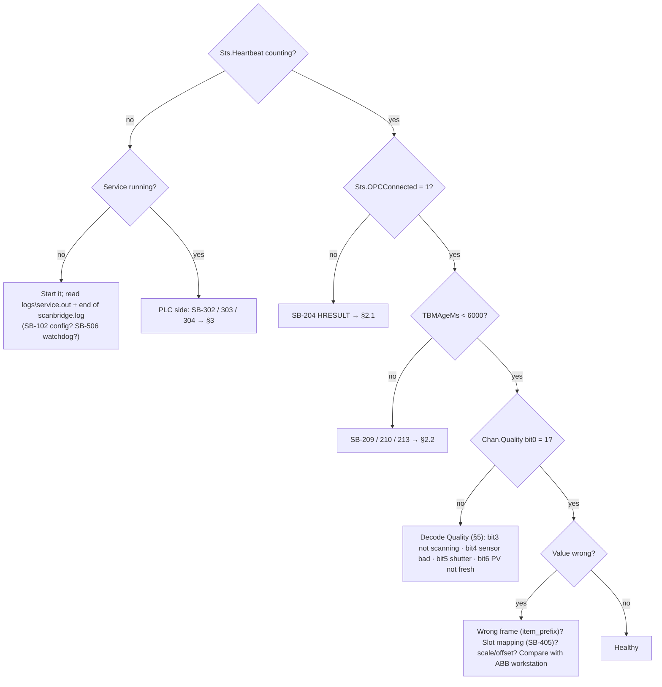

# ScanBridge – Troubleshooting Guide

**Start here.** Three places tell you what's wrong, in this order:

1. **PLC** `<frame>_FromBridge.Sts`: Heartbeat, State, OPCConnected, PLCHbOK, TBMAgeMs, LastError (the number of the last SB-xxx problem).
2. **PC** `py -3.14-32 -m scanbridge status -c <config>`: model state, decoded sensor status, and per-channel quality.
3. **Log** `logs\scanbridge.log`: every important line has an ID like `[SB-204]`; look it up in §4. WARNING and above also go to the Windows Application log under *ScanBridge-<site>*.

## 1. Decision tree

## 2. Scanner / DCOM

### 2.1 Connection errors (SB-204 / 203 / 205)

| HRESULT in log | Meaning | Fix |
|---|---|---|
| `E_ACCESSDENIED 0x80070005` | DCOM refused the identity | `win_dcom_user` must exist on **both** PCs with the same password; check AOS Access/Launch rights; **reboot** after changes; confirm the service runs as `.\win_dcom_user` |
| `RPC_S_SERVER_UNAVAILABLE 0x800706BA` | AOS PC unreachable | ping **both ways**; firewall TCP 135 + dynamic RPC; AOS service started; `opc.node` |
| `RPC_S_CALL_FAILED` / `RPC_E_DISCONNECTED` | link or server dropped mid-call | recovers on its own; if it repeats, check NIC/switch errors and the AOS Event Viewer |
| `CO_E_SERVER_EXEC_FAILURE 0x80080005` | AOS couldn't start | AOS PC Event Viewer → Application: licence, Identity tab |
| `REGDB_E_CLASSNOTREG 0x80040154` | OPC Automation wrapper missing (32-bit) | install x86 OPC Core Components; run **32-bit** Python |
| SB-205 state ≠ RUNNING | AOS not serving | Data Dictionary not configured (ABB guide) |
| SB-203 connect took 45–60 s | multi-homed PC binds RPC to the wrong NIC | put the AOS-facing NIC first in metric/binding order |

These remote-DCOM issues go away once the AOS runs on the same VM (`node = ""`).

### 2.2 Connected, but no data

| Log | Meaning | Fix |
|---|---|---|
| **SB-209** callbacks not arriving | AOS can't call back into this PC | `dcomcnfg` → COM Security → Access Permissions → Edit Limits: allow the AOS's account Remote Access; reboot. Polling keeps data flowing meanwhile |
| SB-209 makepy unavailable | early-bound wrapper missing | run makepy (Installation §3) as admin |
| **SB-213** no trigger change | AOS gets no frame data | AOS event log: "Waiting 10 seconds for tag reassignment"; check the QCS LAN / frame power (ASI TCP 1827) |
| **SB-207** required item missing | `PMx.SPy.TBM5SecDataReadyTrigger`, `TBM5SHeadPosition` or `TBM5SDataBoxNumber` not found | check `item_prefix` spelling; check `item_map.discovered.csv`; does the Data Dictionary contain 5S tags? (otherwise `tbm_rate = "1S"`) |
| **SB-210** snapshot rejected | TBM items not updated together | occasional: fine. Constant: raise `timestamp_tolerance_ms` (500 → 1000) |
| **SB-211** length mismatch | an array length differs | a 1S/5S mix in overrides |
| **SB-212** gaps | refreshes missed | CPU, network, antivirus on the logs folder |

### 2.3 Discovery (SB-206 / 208 / 405)

* **Wrong frame's data:** `item_prefix` must be exactly `MACHINE.FRAME` (e.g. `PM8.SP1`). Run `discover` with an empty prefix to list them.
* **Sensor missing:** item IDs must look like `PM8.SP1.WT1.MEAS.TBM5S`. Section tokens other than `MEAS` (`STDZ`, `SMPLCHK`, `CALSMPL`) are best guesses; see `how = unclassified` rows in `item_map.discovered.csv` and add overrides.
* **SB-405 auto-assigned slot:** pin it in the config so weight can never move to another slot.
* **"OPC items changed since last discovery":** the Data Dictionary was edited; verify slots.

## 3. PLC

| Log | Meaning | Fix |
|---|---|---|
| **SB-302** connect failed / lost | no EtherNet/IP session | ping; `plc.ip` / `slot`; ENBT → `connection_size = 508`; module connection count |
| **SB-303** layout mismatch | tags missing or sized differently | import the UDTs generated from **this** config; create both tags; External Access Read/Write |
| **SB-304** `Path segment error` | missing member (old UDT) | regenerate + re-import |
| **SB-304** privilege / external access | tag is Read Only externally | External Access = Read/Write |
| **SB-305** PLC heartbeat stale | logic not incrementing `ToBridge.Heartbeat` | PLC in Program mode or routine not scheduled |
| **SB-310** request discarded (−9) | ReqID changed while the link was down | re-issue |
| **SB-309** rejected | see `CmdResult` | −7 WriteEnable · −8 LOCAL/workstation · −6 range or slope 0 |
| **SB-215** OPC write failed | server refused | HRESULT in log: BADRIGHTS / BADTYPE / RANGE |

## 4. Log ID reference
